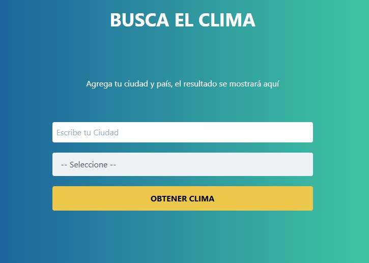
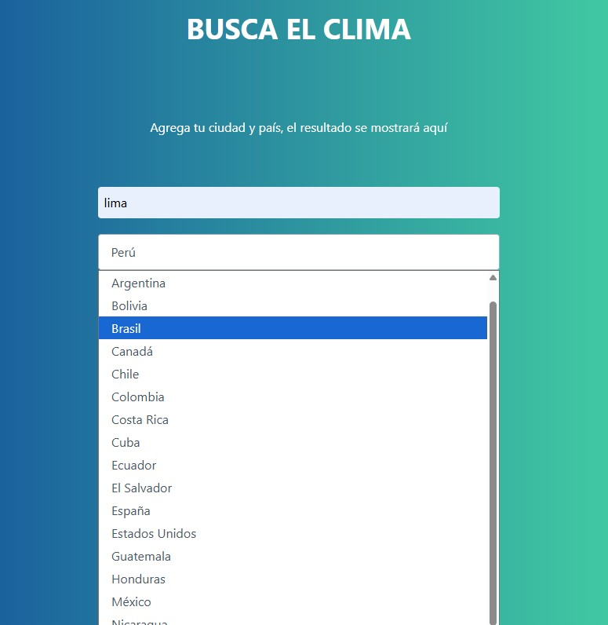
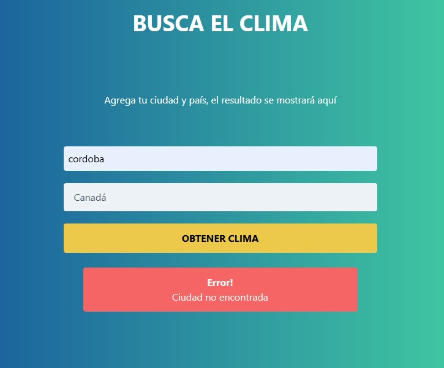
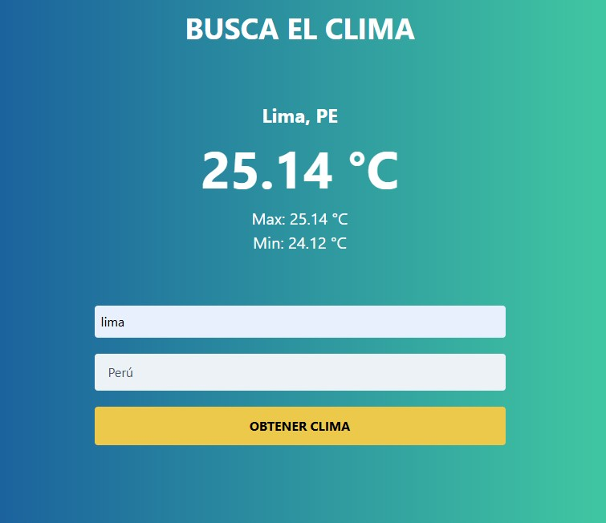

# Weather App

A weather application built with Vanilla JavaScript that allows users to search for current weather conditions by city and country using the OpenWeatherMap API.

## Live Demo

[View the project](https://absantamariav.github.io/weather-app/)

## Features

* **Weather Search**: Search for weather information by entering a city and selecting a country.
* **API Integration**: Retrieve real-time weather data using the OpenWeatherMap API and the Fetch API.
* **Temperature Conversion**: Convert temperatures from Kelvin to Celsius.
* **Weather Information**: Display current, maximum, and minimum temperatures.
* **Form Validation**: Validate required fields before making API requests.
* **Loading Indicator**: Display an animated spinner while retrieving weather information.
* **Error Handling**: Show notification messages when required fields are missing or a city cannot be found.
* **Dynamic DOM Manipulation**: Update the interface dynamically using JavaScript.

## Technologies

* HTML5
* CSS3
* JavaScript (ES6+)
* JavaScript Modules (ES Modules)
* Fetch API
* OpenWeatherMap API
* Tailwind CSS

## 📸 Screenshots

### Main Interface


### Search City


### Alert Error


### Search Successful


## Run Locally

Clone the repository:

```bash
git clone https://github.com/absantamariav/weather-app.git
```

Open the project folder and run `index.html` using a local development server such as **Live Server** in Visual Studio Code.

## Author

**Anderson Santamaria**

* GitHub: [@absantamariav](https://github.com/absantamariav)
